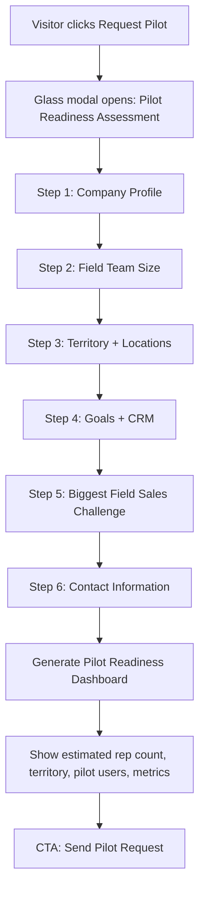
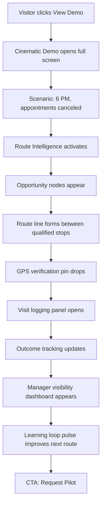

# Prometheus RouteIQ CTA Experience Upgrade

Purpose: upgrade PrometheusRouteIQ.com so `Request Pilot` and `View Demo` feel like intelligent product experiences, not generic website buttons.

Audience: Chris, Larry, Phil, Dallas leadership, field-sales operators, business owners, and early pilot prospects.

Principle: show what Prometheus IQ does and why it matters, without revealing how the underlying intelligence works.

## Executive Direction

PrometheusRouteIQ.com should make one thing clear within the first minute:

Prometheus IQ is not a CRM. It is an intelligence operating system for field sales.

The two CTAs should split the buyer journey cleanly:

- `Request Pilot`: qualify the company and generate a personalized pilot-readiness dashboard.
- `View Demo`: show a cinematic field-sales crisis and how Prometheus turns chaos into direction.

Both experiences should feel premium, interactive, and serious enough for executive review.

## User Flow Diagrams

### Request Pilot Flow

### View Demo Flow

## Screen-by-Screen Layouts

### Request Pilot Experience

#### Screen 1: Pilot Readiness Assessment

Layout:

- Full-screen dark glass overlay.
- Prometheus flame pulse at top center.
- Short title: `Build Your Field-Sales Pilot`
- Subtext: `Answer a few questions and Prometheus will generate a pilot-readiness snapshot for your team.`
- Progress indicator: `1 of 6`

Fields:

- Company Name
- Industry

UX behavior:

- Smooth slide-in transition.
- No long paragraph.
- Use one or two fields per screen max.

#### Screen 2: Field Team Size

Fields:

- Number of Field Reps
- Number of Locations

Visual:

- Small animated rep nodes and location dots appear as values are entered.

UX behavior:

- Rep count drives preview text: `Small team`, `Regional team`, or `Enterprise field team`.

#### Screen 3: Territory

Fields:

- Geographic Territory

Visual:

- Holographic territory ring expands behind the form.

Examples:

- `South Houston`
- `Dallas-Fort Worth`
- `Houston market`
- `Multi-location regional team`

#### Screen 4: Primary Goal

Field:

- Primary Goal

Options:

- More Sales
- More Leads
- Better Accountability
- Better Routing
- Better Event Discovery

Visual:

- Each goal lights up a different intelligence node.

#### Screen 5: Current System + Challenge

Fields:

- Current CRM
- Biggest Field Sales Challenge

Examples:

- HubSpot
- Salesforce
- Spreadsheet
- None
- Other

Challenge prompt:

`What is the biggest problem your field team runs into before a sale ever enters the CRM?`

#### Screen 6: Contact

Fields:

- Name
- Email / Phone

Copy:

`Prometheus will generate a pilot-readiness snapshot based on your answers.`

CTA:

- `Generate Readiness Dashboard`

#### Screen 7: Prometheus Pilot Readiness Dashboard

Dashboard cards:

- Estimated Rep Count
- Territory Size
- Potential Opportunity Areas
- Suggested Pilot Duration
- Suggested Pilot Users
- Key Metrics To Track

Example output logic:

- `Suggested Pilot Duration`: 14 days for early teams, 30 days for larger teams.
- `Suggested Pilot Users`: 1-3 users for initial proof, 5-10 for multi-location proof.
- `Key Metrics`: verified visits, leads, conversations, units/sales, follow-ups, field sessions, route usefulness.

CTA:

- Primary: `Send Pilot Request`
- Secondary: `Download Snapshot` later, not MVP.

Important:

- This dashboard should feel personalized, but it should not claim guaranteed ROI.
- Use language like `suggested`, `estimated`, and `recommended`.

### View Demo Experience

#### Scene 1: The Pressure Moment

Copy:

`It is 6 PM.`

`Every appointment canceled.`

`Your boss says: go generate business.`

Visual:

- Dark field-sales command screen.
- Empty calendar cards collapse.
- Quota indicator turns amber.
- Territory map fades in.

Motion:

- Slow cinematic zoom.
- Subtle flame pulse.

#### Scene 2: Route Intelligence Activates

Copy:

`Prometheus turns the field into direction.`

Visual:

- Holographic map grid.
- Route pulse starts at current location.
- Qualified business nodes appear one by one.

Do not show:

- Scoring formulas.
- Internal weights.
- Proprietary ranking logic.

#### Scene 3: Opportunity Discovery

Visual:

- Business cards appear as nodes:
  - Auto shop
  - Restaurant
  - Apartment complex
  - Salon
  - Dental office
  - Event

Card fields:

- `Walk First`
- `Ask For`
- `Access Type`
- `Why This Stop`

Tone:

- Specific enough to feel useful.
- High-level enough to protect the intelligence layer.

#### Scene 4: GPS Verification

Visual:

- Pin drops onto selected business.
- Verification ring closes.
- `Verified Visit` badge appears.

Copy:

`Activity becomes accountable without tracking the entire day.`

#### Scene 5: Visit Logging

Visual:

- Fast glass panel slides in.
- Inputs animate:
  - Conversations
  - Leads
  - Follow-ups
  - Sales / Units
  - Notes

UX:

- Show the workflow as fast and rep-friendly.
- Avoid making the rep look buried in admin work.

#### Scene 6: Outcome Tracking

Visual:

- Outcome pulse travels back into the Prometheus core.
- A route node changes from neutral to high-signal.

Copy:

`Every visit becomes intelligence for the next move.`

#### Scene 7: Manager Visibility

Visual:

- Manager dashboard rises behind the route map.
- Show:
  - Verified visits
  - Leads
  - Outcomes
  - Route effectiveness
  - Rep activity

Copy:

`Leadership sees field activity clearly, without micromanaging every mile.`

#### Scene 8: Learning Loop

Visual:

- Visit -> Result -> Intelligence -> Better Route
- The flame brightens.
- Fresh route nodes appear.

Final CTA:

- `Request Pilot`

## Interactive Experience Design

### Request Pilot Interaction Model

Experience type:

- Multi-step modal.
- No page reload.
- Saves answers locally until submitted.
- Clear back/next controls.

Interaction details:

- Progress bar at top.
- Animated intelligence nodes respond to form choices.
- Dashboard appears instantly after final step.
- Final submission can use email link or future backend capture.

Recommended MVP behavior:

- Generate dashboard in-browser.
- Final CTA opens a prefilled email to `prometheusrouteiq@gmail.com`.
- Later version can send to a secure backend or CRM.

### View Demo Interaction Model

Experience type:

- Full-screen cinematic overlay.
- Scroll or click advances scenes.
- Each scene has one main message.

Controls:

- `Next`
- `Back`
- `Skip to Pilot Request`
- Progress markers: Pressure, Route, Verify, Log, Learn, Manage.

Animation style:

- Smooth camera movement.
- Route lines draw across map.
- Nodes pulse in sequence.
- Glass UI panels float above the map.
- Flame stays as the intelligence core.

## 3D Animation Recommendations

### Hero to CTA Transition

When a CTA is clicked:

- Background darkens.
- Flame compresses into a bright intelligence core.
- Map grid expands from behind the flame.
- CTA experience launches from the core.

### Request Pilot Visual System

Use:

- Minimal 3D forms.
- Territory rings.
- Rep/location node count.
- Subtle heat-map pulse.

Avoid:

- Over-animated form fields.
- Visuals that distract from completing the assessment.

### View Demo Visual System

Use:

- Holographic route map.
- Business intelligence nodes.
- Connection lines.
- GPS verification rings.
- Glass dashboard cards.
- Warm fire lighting with teal intelligence accents.

Animation sequence:

1. Calendar collapse.
2. Territory grid appears.
3. Route line draws.
4. Business nodes light up.
5. GPS pin verifies.
6. Visit outcome logs.
7. Manager dashboard appears.
8. Learning loop pulses.

Performance guidance:

- Keep the demo scene lightweight.
- Use CSS/canvas/SVG for route and node animation where possible.
- Use Three.js only for the flame/core/background, not every UI panel.
- Respect reduced-motion settings.

## Data Collection Architecture

### Request Pilot Data Model

Fields:

- companyName
- industry
- fieldRepCount
- locationCount
- geographicTerritory
- primaryGoal
- currentCrm
- biggestChallenge
- contactName
- contactMethod
- createdAt

Derived dashboard values:

- territoryComplexity
- suggestedPilotDuration
- suggestedPilotUsers
- opportunityAreaLabels
- recommendedMetrics

Important:

- Do not collect sensitive employee data during public onboarding.
- Do not promise revenue outcomes.
- Do not expose internal scoring.

### Suggested Dashboard Rules

Rep count:

- 1-3 reps: `Focused proof pilot`
- 4-15 reps: `Team pilot`
- 16+ reps: `Market-level pilot`

Locations:

- 1 location: `Single-location pilot`
- 2-5 locations: `Controlled market pilot`
- 6+ locations: `Regional operating pilot`

Primary goal mapping:

- More Sales -> units, conversion rate, field sessions.
- More Leads -> conversations, leads, follow-ups.
- Better Accountability -> GPS verified visits, visit completion rate.
- Better Routing -> route usefulness, miles saved, stop completion.
- Better Event Discovery -> events found, event visits, event outcomes.

### Submission Path

Phase 1:

- Generate dashboard locally.
- Final button opens a prefilled email.

Phase 2:

- Secure backend capture.
- Confirmation email.
- Internal pilot lead dashboard.

Phase 3:

- CRM integration after pilots prove demand.

## CTA Conversion Strategy

### Request Pilot CTA

Primary conversion goal:

- Move serious business prospects into a structured pilot conversation.

Best copy:

- `Request Pilot`
- `Build My Pilot Snapshot`
- `Generate Pilot Readiness`

Why it works:

- It feels more valuable than a plain contact form.
- It helps the prospect understand their own field-sales problem.
- It creates an executive artifact for follow-up.

### View Demo CTA

Primary conversion goal:

- Make the visitor feel the pain and see the product value.

Best copy:

- `View Demo`
- `Run Field Scenario`
- `See Prometheus In Action`

Why it works:

- It avoids a boring product video.
- It creates emotional urgency.
- It explains Prometheus without revealing proprietary methods.

### Final CTA Hierarchy

Hero:

- Primary: `Request Pilot`
- Secondary: `View Demo`

After demo:

- Primary: `Request Pilot`
- Secondary: `Replay Scenario`

After readiness dashboard:

- Primary: `Send Pilot Request`
- Secondary: `Review Answers`

## Leadership-Safe Positioning

Use:

- `field-sales intelligence`
- `route guidance`
- `verified activity`
- `pilot-readiness snapshot`
- `outcome tracking`
- `manager visibility`

Avoid:

- Secret sauce language.
- Patent claims.
- Guaranteed ROI.
- Proprietary algorithm details.
- Internal data model details.
- Claims that imply employee surveillance.

## Build Priority

### Phase 1: MVP Upgrade

Build:

- Request Pilot multi-step modal.
- In-browser pilot-readiness dashboard.
- View Demo cinematic scenario overlay.
- Basic route/node animation.
- Prefilled email submission.

Do not build yet:

- Backend lead database.
- CRM integrations.
- Login accounts.
- Downloadable PDF snapshots.

### Phase 2: Premium Layer

Build:

- More advanced map animation.
- Better scene transitions.
- Demo replay controls.
- Founder-facing lead review table.

### Phase 3: Enterprise Layer

Build:

- Secure backend lead capture.
- Domain email confirmations.
- CRM sync.
- Analytics for CTA conversion.

## Final Recommendation

The highest ROI website upgrade is not adding more sections. It is turning the two CTAs into product experiences.

`Request Pilot` should make the visitor feel understood.

`View Demo` should make the visitor feel the 6 PM field-sales problem and then watch Prometheus bring order to it.

If executed well, the website will communicate:

Prometheus IQ is the intelligence layer behind field sales, not another CRM screen.
