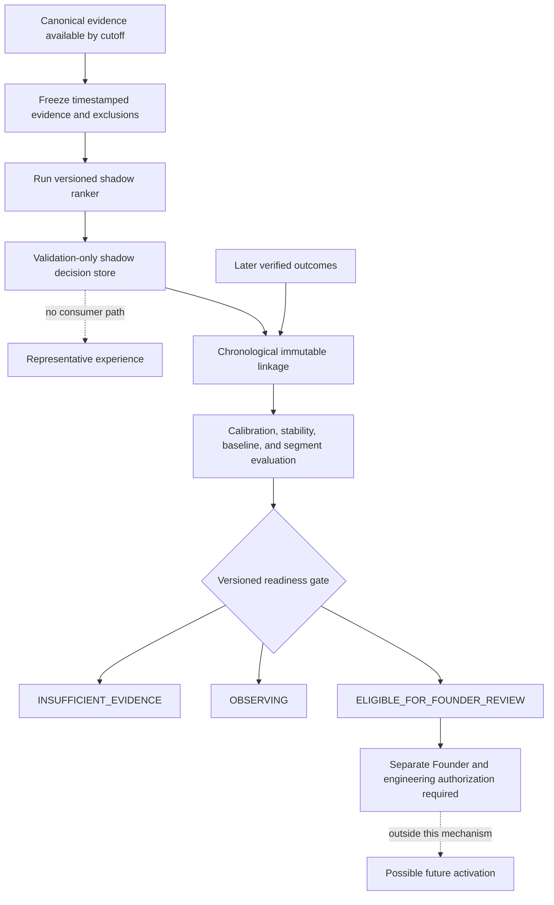

# Route IQ Shadow Decision Validation and Recommendation Readiness Gate v1

Recorded: 2026-07-13

Engineering directive: Route IQ Shadow Decision Validation + Recommendation Readiness Gate v1

Related invention record: IP-001 - Route IQ Adaptive Representative Intelligence System

Related subsystem: Prometheus Patents / Route IQ

Status: Pre-implementation technical invention evidence record for a post-filing development. This document does not make a patentability, infringement, validity, or other legal conclusion.

## Date Conceived And Documented

This mechanism was documented on 2026-07-13 before Intelligence implementation under the permanent Route IQ Invention Documentation Rule. The current repository record does not establish whether the Founder conceived this exact shadow-decision validation and recommendation-readiness mechanism earlier. Founder confirmation and any earlier dated notes, messages, diagrams, prototypes, or test artifacts remain required before assigning an earlier conception date.

## Technical Problem Solved

A recommendation model can appear useful in offline scoring while still being unsafe to activate. Evaluation performed against mutable evidence can leak later outcomes into an earlier decision, omit candidates that were actually available, change exclusions after the fact, or compare model versions on different evidence. Aggregate accuracy can also hide poor probability calibration, unstable rankings, weak performance against a simpler baseline, or failure in a representative, territory, category, evidence-maturity, or other operational segment.

The technical problem is therefore to reproduce what Route IQ could have decided at a particular time, observe that ranked decision without influencing a representative, link later outcomes in chronological order, and govern whether the accumulated evidence is sufficient even to consider a separate recommendation activation decision.

## Technical Solution

The mechanism creates a versioned validation path with the following cooperating controls:

1. **Timestamped evidence freeze.** Each validation decision is computed from an immutable evidence snapshot bounded by an `as_of` timestamp. The snapshot records workspace, representative and operating scope; source and schema versions; candidate universe; eligibility rules; evidence cutoff; excluded records and exclusion reason codes; and a stable snapshot identifier or content digest. Evidence created, received, corrected, or admitted after the cutoff cannot affect that frozen decision.
2. **Ranked shadow decisions.** The shadow evaluator records the ordered eligible candidates that Route IQ would have presented. Each entry preserves rank, candidate identity, predicted outcome probability, confidence or uncertainty, model and policy version, evidence cutoff, eligibility provenance, and applicable exclusion context. The full governed exclusion ledger is retained so that absence from the ranking is explainable.
3. **Zero-influence isolation.** Shadow outputs are written to a validation-only store or namespace that has no representative-facing consumer and no write path into production recommendation queues, route ordering, scoring inputs, representative profiles, learned production state, or Dashboard behavior. Shadow decisions do not trigger navigation, notification, assignment, replenishment, or recommendation activation.
4. **Chronological outcome linkage.** A later verified outcome may be linked to a frozen shadow decision only through stable decision, candidate, representative, workspace, and time identities. The linkage preserves outcome timestamp, ingestion timestamp, provenance, normalization version, attribution window, and censoring or missing-outcome status. Later outcomes annotate the frozen record; they do not recompute or mutate the historical ranking.
5. **Multi-axis evaluation.** Versioned evaluation jobs measure probability calibration, discrimination or ranking quality, temporal and rerun stability, performance against a declared baseline, evidence coverage, and performance by governed segments. Segment evaluation may include representative, territory, business category, time window, evidence maturity, operating profile, decision source, and confidence band. Insufficient samples remain explicitly unavailable rather than being pooled into unsupported conclusions.
6. **Governed readiness states.** A deterministic gate evaluates versioned thresholds, minimum observation counts, observation duration, outcome completeness, calibration limits, stability limits, baseline comparison, segment floors, critical failure conditions, and unresolved exclusions. It emits a readiness state with reason codes and evidence references. A passing technical state means only that stated validation criteria were met; it does not activate recommendations.

### Governed Readiness State Model

The readiness state is restricted to exactly these three values:

- `INSUFFICIENT_EVIDENCE`: required frozen decisions, linked outcomes, observation duration, sample support, outcome maturity, coverage, or trustworthy integrity evidence is insufficient to perform the governed assessment.
- `OBSERVING`: sufficient evidence exists to continue governed evaluation, but observation is ongoing or one or more technical gates, segment floors, limitations, blockers, integrity checks, review flags, or governance holds remain unresolved.
- `ELIGIBLE_FOR_FOUNDER_REVIEW`: all configured technical criteria have passed, required evidence is complete, and no blocking review flag or governance hold remains; the evidence package may be presented to the Founder for review.

Integrity failures, holds, blockers, failed gates, and limitations are recorded as reason codes, gate results, or review flags associated with one of those three states. They are not additional readiness states. `ELIGIBLE_FOR_FOUNDER_REVIEW` does not authorize recommendation activation, production exposure, or any product, safety, legal, business, or engineering approval. Recommendation activation requires a distinct, separately authorized engineering and governance change outside this mechanism.

## System Impact And Boundaries

- Adds reproducible evidence about what the system would have recommended at a historical instant and why.
- Separates decision-time inputs from later outcome evidence and prevents temporal leakage.
- Enables model, policy, cutoff, baseline, and segment comparisons over like-for-like frozen evidence.
- Makes readiness explainable through versioned thresholds, reason codes, failed checks, exclusions, and evidence references.
- Supports audit, regression analysis, and human review without changing representative behavior.
- Does not expose shadow decisions, ranks, probabilities, confidence, exclusions, or readiness states to representatives.
- Does not activate, reorder, replace, replenish, suppress, or otherwise influence recommendations.
- Does not modify Data ownership, canonical field evidence, Dashboard or UI behavior, production scoring, runtime routes, or existing production learning state.
- Does not convert a technical gate result into a product, safety, legal, or business approval.

## Computer Implementation And Data Flow

A computer implementation may use these versioned records:

- `EvidenceFreezeManifest`: snapshot identity, cutoff, scope, source versions, admitted evidence identities, candidate universe, eligibility version, exclusion ledger, creation timestamp, and digest.
- `ShadowDecisionRecord`: decision identity, freeze identity, evaluation timestamp, model and policy versions, ordered candidates, probabilities, confidence, ranks, and zero-influence assertion.
- `OutcomeLinkRecord`: decision and candidate identities, verified outcome, event and ingestion timestamps, provenance, attribution rule version, maturity, and censoring state.
- `EvaluationReport`: metric definitions and versions, calibration and ranking results, stability comparisons, baseline definition and result, segment results, coverage, sample sizes, confidence intervals or uncertainty, and failures.
- `ReadinessAssessment`: gate configuration version, input report identities, state, reason codes, threshold results, reviewer eligibility, hold status, and generation timestamp.

The isolation boundary represented by the dotted path is enforced by separate storage or access control, explicit consumer allowlists, validation-only artifact classification, and tests or audits demonstrating that runtime recommendation inputs and outputs are unchanged. Repeated evaluation of the same freeze, model version, policy version, and configuration should produce the same ranked record and assessment, subject only to explicitly versioned deterministic computation rules.

## Evaluation Detail

- **Calibration:** compare predicted probability bands with matured observed outcome rates using declared metrics and minimum support.
- **Stability:** compare rankings, probabilities, and readiness outcomes across deterministic reruns, adjacent frozen windows, and approved version changes; identify excessive drift.
- **Baseline:** compare against a declared and versioned reference such as current production policy, distance-only ordering, category prior, or another authorized non-shadow strategy using the same eligible universe and cutoff.
- **Segments:** evaluate configured operational cohorts separately and prevent strong aggregate results from masking a critical segment failure.
- **Exclusions and censoring:** report excluded candidates, immature outcomes, missing outcomes, invalid links, and unsupported segments; do not silently treat them as failures or successes.
- **Gate integrity:** fail closed on cross-workspace data, post-cutoff evidence, missing versions, mutable snapshot content, chronology violations, unauthorized consumers, or incomplete critical metrics.

## Alternative Embodiments

- Evidence may be frozen by materialized snapshot, immutable event-log position, bitemporal query, signed manifest of content-addressed records, or reproducible warehouse snapshot.
- Shadow evaluation may run synchronously beside a production decision, asynchronously from captured decision context, in batch replay, or in an isolated simulation environment.
- The system may preserve the entire candidate universe or a governed eligible subset plus a complete exclusion ledger.
- Outcome linkage may use direct event identifiers, a governed attribution window, survival or time-to-event analysis, delayed-label maturation, or authorized human adjudication.
- Calibration may use reliability bands, Brier score, log loss, expected calibration error, or another versioned method appropriate to the outcome.
- Stability may use rank correlation, top-k overlap, score drift, transition frequency, or deterministic replay equality.
- Baselines may be global, representative-specific, territory-specific, current-production, heuristic, or champion-model policies, provided the baseline is versioned and uses the same frozen evidence.
- Readiness may be evaluated globally and per operating profile, with critical-segment vetoes, risk-weighted thresholds, sequential evaluation, or a human hold.
- A privacy-preserving embodiment may tokenize business and representative identities while retaining stable linkage and workspace isolation.

## Supporting Diagrams And Screenshot Status

The Mermaid data-flow and governance diagram above is the initial supporting diagram. A later implementation evidence package may add freeze-manifest, sequence, isolation-boundary, metric, and readiness-state diagrams.

Screenshot status: none. No UI or representative-facing implementation is authorized by this documentation task, and no screenshot is asserted as evidence. If a future internal validation console is implemented, screenshots should be dated, scoped, redacted as needed, and linked without implying representative exposure or production activation.

## Relationship To The Filed Route IQ Invention

The Founder-filed Route IQ U.S. provisional application record identifies application number 64/107,865 and a filing receipt timestamp of 2026-07-09 12:52:12 AM ET. That filed record remains preserved and unchanged.

This 2026-07-13 mechanism is documented as a post-filing development related to the existing IP-001 representative intelligence, probability, recommendation, evidence, confidence, and outcome-learning architecture. The filed provisional is referenced only as historical context. This record does not state that the new material was included in that filing, does not amend the filed record, and makes no priority, support, scope, patentability, infringement, validity, or filing-strategy conclusion.

## Preservation Decision Options

The following options are preserved for Founder and patent-counsel review; this record does not choose a legal strategy:

1. Maintain the existing provisional application record only as historical context for the earlier Route IQ invention and preserve this record separately as dated post-filing evidence.
2. Consider confidential or trade-secret handling for non-public thresholds, calibration methods, segment veto logic, baseline selection, scoring details, access-control design, and operational validation results.
3. Ask patent counsel whether the post-filing material should be reviewed for a future filing, continuation, continuation-in-part, divisional, or other legally appropriate path. Counsel should determine which, if any, option is available or suitable.

## Founder And Counsel Follow-Up

- Founder: confirm whether this exact mechanism was conceived before 2026-07-13 and identify supporting dated evidence.
- Founder: identify contributors to the mechanism and any private or public disclosure.
- Engineering after authorization: preserve versioned schemas, fixtures, validation results, isolation evidence, and the first successful shadow run without altering this pre-implementation record.
- Counsel: review the relationship between this post-filing record and the filed Route IQ materials and advise on confidentiality and any future preservation or filing action.
