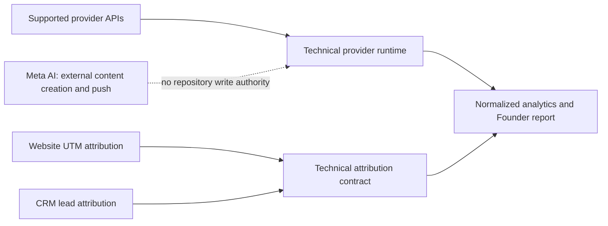

# Social Media Technical Analytics Architecture v2

Owner: Prometheus Social Media

## Ownership Boundary

The repository owns only the technical social layer: provider-safe Instagram
callback and token runtime, normalized analytics and reporting, security,
Website and UTM attribution, CRM attribution, and approved-claims controls.

Meta AI is the external owner for ordinary social content creation and social
push. Campaign calendars, content-production schedules, campaign planning, and
manual posting operations are not canonical repository artifacts.

## Provider And Security Rules

Instagram uses supported Meta APIs through backend-only runtime controls. Other
providers remain unconfigured until separately governed. Password login,
scraping, social account browser automation, frontend tokens, live posting,
messaging, comments, and DMs are prohibited repository capabilities.

Infrastructure owns production secret storage, OAuth redirect configuration,
token lifecycle protection, backend route protection, and deployment settings.
Integrations may own approved OAuth connection, refresh, webhook, or polling
flows. Neither boundary grants content-production or posting authority.

## Technical Contracts

The canonical contract is `social-media/contracts/social-media-contract.js`.
It normalizes provider state, social metrics, attribution events, and analytics
snapshots. Website and CRM may exchange bounded attribution metadata through the
registered contracts; Dashboard and Research may consume canonical reports but
must not read raw provider output, fabricate metrics, or cross workspaces.

The current implementation includes the Instagram provider adapter, backend
runtime checks, OAuth lifecycle, normalized analytics service, and read-only
Founder report. Sample analytics remain explicitly nonproduction.

## Reddit Research Boundary

Reddit assistance is Founder-attended research only. The Founder initiates each
session and performs every account action. Assistance is limited to a bounded
search or Founder-selected discussion, no more than five advisory talking
points, and a review of community rules, affiliation, promotion, disclosure,
and claims risk. No credentials, autonomous monitoring, posting, commenting,
replying, voting, following, messaging, scheduling, or recurring quota is stored
or operated by the repository.

## Duplicate Prevention

Other subsystems consume the registered technical contracts instead of
rebuilding provider, attribution, or reporting logic. Missing canonical local
paths fail closed; explicit external ownership uses an `external:` identifier,
and historical evidence uses an exact commit-pinned `git:` reference.
