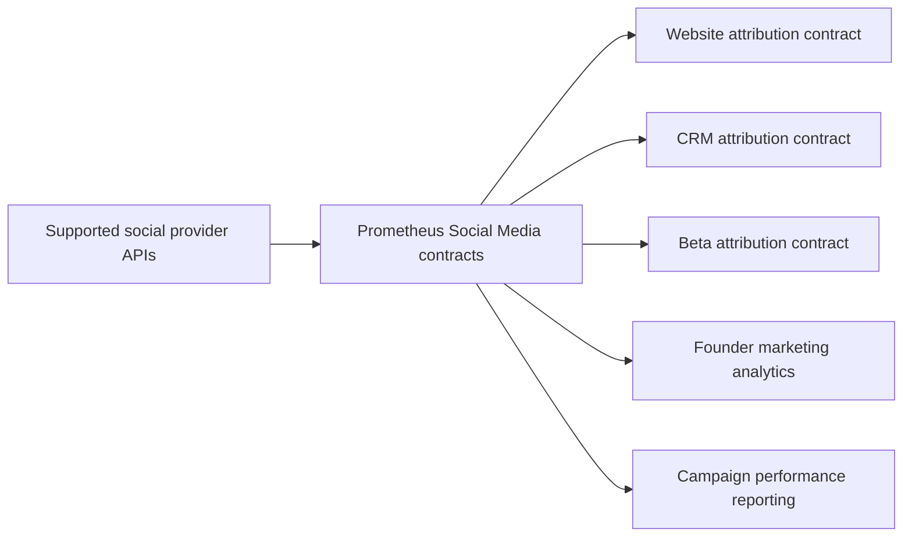

# Social Media / Marketing Analytics Architecture v1

Date: 2026-06-30
Owner: Prometheus Social Media

## Audit Summary

Existing Social Media sources reviewed:

- `AGENTS.md`
- `README.md`
- `docs/TEST_RELEASE_MAP.md`
- `PRODUCT_VISION.md`
- `PROMETHEUS OPERATING SYSTEM/07 Marketing & Social Media/README.md`
- `.founder-review/final-green-repository-checkpoint-v1/untracked/social-media/`
- `social-media/env.example`

Findings:

- The live `social-media/` folder only retained an ignored environment example.
- A previous Instagram-focused Companion Social Media Manager existed only as preserved checkpoint material.
- Meta/Instagram setup was blocked by external Meta account/app configuration.
- No committed provider-neutral Social Media analytics foundation existed before this work.

## Architecture

Social Media owns normalization and reporting for marketing performance. Other subsystems should send or consume normalized contract records instead of implementing their own attribution model.

## Provider Architecture

Provider adapters must use supported APIs only.

Active provider target:

- Instagram: Meta Graph API with Instagram Business or Professional account analytics.

Future provider targets, not configured in Instagram Runtime Controls v1:

- Facebook: Meta Graph API Page insights.
- LinkedIn: LinkedIn Marketing API and Organization analytics.
- X: X API analytics where the account tier and API product allow it.
- TikTok: TikTok for Developers or TikTok Business APIs.
- YouTube: YouTube Data API plus YouTube Analytics API.

Unsupported provider methods:

- Password login.
- Browser automation.
- Scraping.
- Live posting.
- Frontend token usage.

## Contracts Created

Official contract file:

- `social-media/contracts/social-media-contract.js`

Contract version:

- `social-media-marketing-analytics-contract.v1`

Primary normalized records:

- Provider status.
- Campaign descriptor.
- Social metric.
- Attribution event.
- Marketing analytics snapshot.

Attribution targets:

- `website_traffic`
- `crm_lead`
- `beta_signup`
- `founder_analytics`
- `campaign_performance`

## Downstream Handoff Contracts

Website should provide website attribution events with:

- `utm_source`
- `utm_medium`
- `utm_campaign`
- `utm_content`
- `landing_path`
- `referrer`
- `occurred_at`
- privacy-safe visitor/session identifier if approved

CRM should provide lead attribution events with:

- `lead_id`
- `source`
- `campaign_id`
- `created_at`
- lifecycle status
- revenue or opportunity value only when CRM policy allows it

Beta intake should provide beta attribution events with:

- `beta_participant_id`
- `campaign_id`
- `signup_at`
- beta source
- privacy-safe participant metadata only

Founder analytics should consume:

- provider status
- campaign summaries
- account-level metrics
- campaign attribution summary
- clear sample/live source labels

Infrastructure should own:

- production secret storage
- OAuth redirect URLs
- token rotation
- backend route protection
- deployment environment configuration
- Instagram runtime state validation before any live provider call

Integrations should own:

- OAuth app connection flows
- token refresh workflows
- provider webhook or polling jobs if approved

## Current Implementation

Implemented:

- Provider-neutral contract.
- Provider registry for Instagram, Facebook, LinkedIn, X, TikTok, and YouTube.
- Instagram Business provider adapter.
- Instagram-only backend runtime controls for environment validation and safe connection states.
- Live Instagram Business account/profile analytics consumption through the verified runtime path.
- Available content-level Instagram insights normalized as provider API metrics with content metadata.
- Explicit mock/sample fallback.
- Founder marketing sample analytics service.
- Tests for contract validation, secret redaction, provider registry, Instagram fallback, and mocked provider fetch.

Not implemented:

- Browser automation.
- Scraping.
- Live posting.
- Downstream Website, CRM, Dashboard, beta, Infrastructure, or Integrations code changes.
- Facebook posting, X, YouTube, TikTok, LinkedIn, messaging, comments automation, DMs, or password storage.

## Duplicate Prevention

Do not rebuild Social Media provider abstraction, attribution event normalization, campaign descriptor normalization, or marketing analytics snapshots in Website, CRM, Dashboard, Companion, Infrastructure, Integrations, Intelligence Engine, or Data.

Those subsystems should consume `social-media/contracts/social-media-contract.js` or request a documented contract extension from Social Media.
